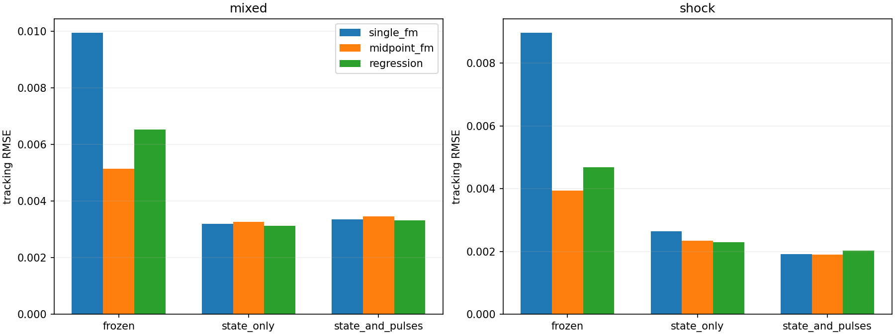
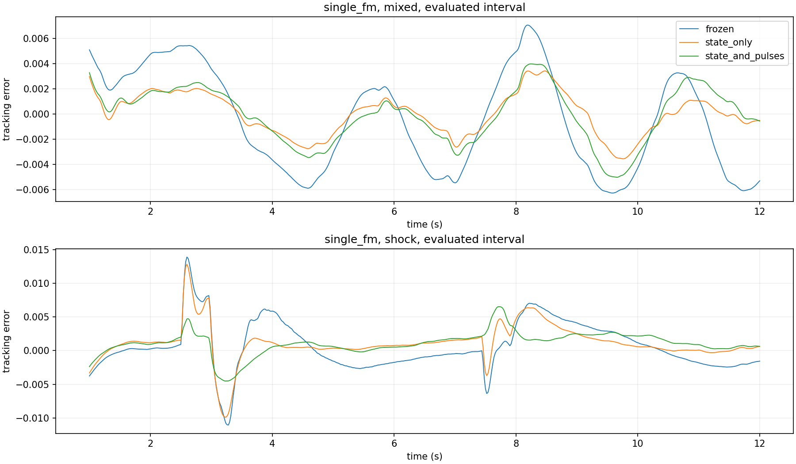

# 单步与多步 FM 的闭环适配实验

## 要回答的问题

检验单步FM在冻结权重闭环测试中的劣势，能否通过闭环数据适配改善；将闭环状态分布变化与冲击信号暴露分成两个适配组，避免把两者的作用混为一谈。

## 实验设计

| 组别 | 训练数据 | 作用 |
|---|---|---|
| frozen | 上一实验开环权重直接使用 | 固定基线 |
| state_only | 闭环下的七类平滑/阶跃混合轨迹，不添加矩形冲击 | 适应闭环状态分布 |
| state_and_pulses | 相同底层轨迹，其中后一半加入矩形冲击 | 再检验冲击暴露的作用 |

模型：single_fm、midpoint_fm、regression；种子[11, 22, 33]，全部本地CPU。各模型从上一实验对应种子的最佳开环权重开始，保持原网络结构、归一化统计、速度/结果损失和归一化标准差0.01的训练源噪声。
每组做两轮闭环收集，每轮360条12秒轨迹。用无补偿、DOB、单步FM、多步FM、回归五种策略等分收集；神经策略使用种子11，第二轮使用第一轮验证选择的权重。同一适配组内所有学习器共享完全相同的数据；第二轮混合第一轮数据回放。
两种适配组的底层扰动、系统参数、初始状态、加速度噪声完全配对；加冲击使用独立随机数流。冲击幅值由J/width定义，|J|∈[0.15,0.35]，宽度0.02/0.08/0.20秒。
每轮2500次更新，合计5000次，batch=128，AdamW学习率0.0002、weight_decay=1e-4、梯度裁剪5；每轮重建优化器。第二轮从第一轮验证选择的最佳模型开始，不从末次权重开始。
每500次更新用独立的12条混合+12条冲击闭环验证轨迹评估，按跨轨迹跟踪MSE平均后开方选择检查点，包含更新0的父模型作为候选。两种适配组共享验证集，验证信号含冲击；state_only仅训练数据不含额外冲击。
收集数据只使用训练规格，训练标签使用仿真扰动真值；部署输入仍仅含过去观测。验证/测试轨迹不加入训练池；控制器、饱和、20ms周期和历史热身规则固定。
独立测试：56条混合轨迹（seed140000）、24条冲击轨迹（seed150000）；测试种子与上一次报告不同，因此通过本实验重跑的frozen基线比较，不能直接拼接旧表数值。
本主实验使用同步、无额外计算延迟的控制，用于隔离适配作用；计算延迟作为独立因素另行复核。

## 独立测试结果

| 测试集 | 适配组 | 方法 | 跟踪RMSE | 扰动RMSE | 冲击RMSE | 饱和比例 |
|---|---|---|---:|---:|---:|---:|
| mixed | frozen | single_fm | 0.00994 | 0.64961 | — | 0.0000 |
| mixed | frozen | midpoint_fm | 0.00514 | 0.57195 | — | 0.0000 |
| mixed | frozen | regression | 0.00653 | 0.41248 | — | 0.0000 |
| mixed | state_only | single_fm | 0.00319 | 0.10426 | — | 0.0000 |
| mixed | state_only | midpoint_fm | 0.00326 | 0.10834 | — | 0.0000 |
| mixed | state_only | regression | 0.00313 | 0.09954 | — | 0.0000 |
| mixed | state_and_pulses | single_fm | 0.00335 | 0.10740 | — | 0.0000 |
| mixed | state_and_pulses | midpoint_fm | 0.00345 | 0.10655 | — | 0.0000 |
| mixed | state_and_pulses | regression | 0.00332 | 0.10280 | — | 0.0000 |
| shock | frozen | single_fm | 0.00897 | 0.79620 | 6.62014 | 0.0001 |
| shock | frozen | midpoint_fm | 0.00394 | 0.77682 | 6.63475 | 0.0000 |
| shock | frozen | regression | 0.00468 | 0.58851 | 6.61855 | 0.0000 |
| shock | state_only | single_fm | 0.00265 | 0.45459 | 6.35955 | 0.0000 |
| shock | state_only | midpoint_fm | 0.00234 | 0.45463 | 6.54118 | 0.0000 |
| shock | state_only | regression | 0.00230 | 0.39529 | 6.51198 | 0.0000 |
| shock | state_and_pulses | single_fm | 0.00191 | 0.15399 | 1.33905 | 0.0002 |
| shock | state_and_pulses | midpoint_fm | 0.00189 | 0.12321 | 0.96047 | 0.0003 |
| shock | state_and_pulses | regression | 0.00203 | 0.14976 | 2.03856 | 0.0000 |

RMSE先平均种子和轨迹的MSE再开方；冲击RMSE仅统计有冲击轨迹。训练种子共享数据，不视为独立数据集重复。

经典控制参照（沿用上一实验验证选择的DOB=24 rad/s、Kalman q=1e5，未用本次测试集调参）：

| 测试集 | 方法 | 跟踪RMSE | 扰动RMSE |
|---|---|---:|---:|
| mixed | none | 0.03097 | 0.67366 |
| mixed | dob | 0.00551 | 0.25965 |
| mixed | kalman | 0.00521 | 0.32721 |
| shock | none | 0.01063 | 0.47606 |
| shock | dob | 0.00459 | 0.36790 |
| shock | kalman | 0.00461 | 0.41469 |

## 单步与多步的差距

- mixed/state_only：单步跟踪RMSE相对冻结模型变化-67.88%；单步/多步跟踪误差比为0.98。负的变化表示适配改善。
- mixed/state_and_pulses：单步跟踪RMSE相对冻结模型变化-66.30%；单步/多步跟踪误差比为0.97。负的变化表示适配改善。
- shock/state_only：单步跟踪RMSE相对冻结模型变化-70.48%；单步/多步跟踪误差比为1.13。负的变化表示适配改善。
- shock/state_and_pulses：单步跟踪RMSE相对冻结模型变化-78.69%；单步/多步跟踪误差比为1.01。负的变化表示适配改善。

## 配对轨迹bootstrap

5000次配对重采样，单位为整条测试轨迹，先对同轨迹不同种子的MSE求平均。区间仅反映固定训练数据与模型条件下测试轨迹抽样的不确定性，不包含训练集变化，未校正多重比较。

| 测试集 | 对比 | 适配组 | 跟踪RMSE差 | 95%区间 |
|---|---|---|---:|---|
| mixed | single_minus_midpoint | frozen | +0.004804 | [+0.004433, +0.005193] |
| mixed | single_minus_midpoint | state_only | -0.000066 | [-0.000111, -0.000023] |
| mixed | single_minus_midpoint | state_and_pulses | -0.000099 | [-0.000163, -0.000037] |
| mixed | adapted_minus_frozen_single | state_only | -0.006747 | [-0.007182, -0.006317] |
| mixed | adapted_minus_frozen_single | state_and_pulses | -0.006590 | [-0.007016, -0.006163] |
| shock | single_minus_midpoint | frozen | +0.005032 | [+0.004431, +0.005643] |
| shock | single_minus_midpoint | state_only | +0.000312 | [+0.000161, +0.000456] |
| shock | single_minus_midpoint | state_and_pulses | +0.000018 | [-0.000091, +0.000138] |
| shock | adapted_minus_frozen_single | state_only | -0.006322 | [-0.007022, -0.005592] |
| shock | adapted_minus_frozen_single | state_and_pulses | -0.007058 | [-0.007522, -0.006614] |

## 验证选择审计

更新0表示保留父模型。全部末次检查点核对已完成规定更新数，最佳检查点核对为验证跟踪误差最低者。

| 组别 | 方法 | 种子 | 第一轮选择更新 | 第二轮选择更新 |
|---|---|---:|---:|---:|
| state_only | single_fm | 11 | 1500 | 500 |
| state_only | single_fm | 22 | 2500 | 0 |
| state_only | single_fm | 33 | 2000 | 0 |
| state_only | midpoint_fm | 11 | 500 | 0 |
| state_only | midpoint_fm | 22 | 2500 | 0 |
| state_only | midpoint_fm | 33 | 2500 | 500 |
| state_only | regression | 11 | 2500 | 2000 |
| state_only | regression | 22 | 1500 | 2500 |
| state_only | regression | 33 | 2500 | 1500 |
| state_and_pulses | single_fm | 11 | 2000 | 0 |
| state_and_pulses | single_fm | 22 | 2500 | 0 |
| state_and_pulses | single_fm | 33 | 1000 | 2500 |
| state_and_pulses | midpoint_fm | 11 | 2000 | 500 |
| state_and_pulses | midpoint_fm | 22 | 2000 | 1500 |
| state_and_pulses | midpoint_fm | 33 | 2500 | 1000 |
| state_and_pulses | regression | 11 | 1000 | 2500 |
| state_and_pulses | regression | 22 | 1500 | 2000 |
| state_and_pulses | regression | 33 | 2500 | 2500 |

## 边界与解释

这是仿真中的监督离线适配，不是部署时使用真值的在线学习，也不是对跟踪损失直接反向传播。训练仍优化扰动监督损失，跟踪误差仅用于独立验证模型选择。
第二轮共同数据池依赖第一轮种子11的适配控制器，因此不同种子并非独立收集数据重复。每轮验证包括父模型；若没有改进，可以保留父模型，需同时查看选择步骤。
额外冲击适配组同时改变信号暴露和由此产生的闭环状态，不能声称完全分离二者的因果贡献。state_only也包含原先的阶跃信号，仅不包含新增的窄矩形冲击。
真实传感器、系统参数失配、模型结构/超参数独立调优尚未覆盖。比较的是相同更新次数，单步/多步训练计算量不同。

## 复现与产物

```powershell
.\.venv\Scripts\python.exe -m unittest test_adaptation test_single_step test_core closed_loop.test_core -v
.\.venv\Scripts\python.exe adaptation_experiment.py
# 中断后使用相同参数加 --resume
```

config.json、source_hashes.json、split_manifest.json记录配置与隔离；各组目录含每轮最佳、末次权重和验证历史。训练窗口缓存cache/留在本地且不提交，可由收集规格与检查点重建；每轮manifest记录缓存SHA-256和收集策略。test_metrics.json保留逐轨迹指标。





## 补充结论与验证

本次闭环并加入冲击适配后，单步/多步跟踪RMSE比从冻结时的2.28降至1.01。配对区间跨过零，未观察到明确的跟踪差距；这不是预先设定等效界值的统计等效检验。
冲击扰动估计仍有差距：单步冲击RMSE=1.33905，多步=0.96047，单步高约39.4%。跟踪接近不代表估计精度完全相同。
加入冲击后，混合测试集误差略有增加，存在任务分布取舍；更多冲击训练不保证所有信号都改善。
未加入同预算开环继续训练对照，因此本次改善属于“闭环数据微调+闭环验证选择”的整体流程，不能完全排除额外优化步数或选择指标变化的贡献。此限制不影响对本流程实际测试结果的比较。
源文件与初始权重SHA-256、36个每轮最佳检查点的部署调用次数、独立延时实现的零延时结果均已核验。26项单元测试通过，详细见verification.json。
计算延时的独立结果见[延时复核报告](../computation_delay/REPORT.md)。它使用软件耗时分位数与指定调度模型，不是实际硬件在环测试。

补充分析复现：`.\.venv\Scripts\python.exe analyze_adaptation.py`。
