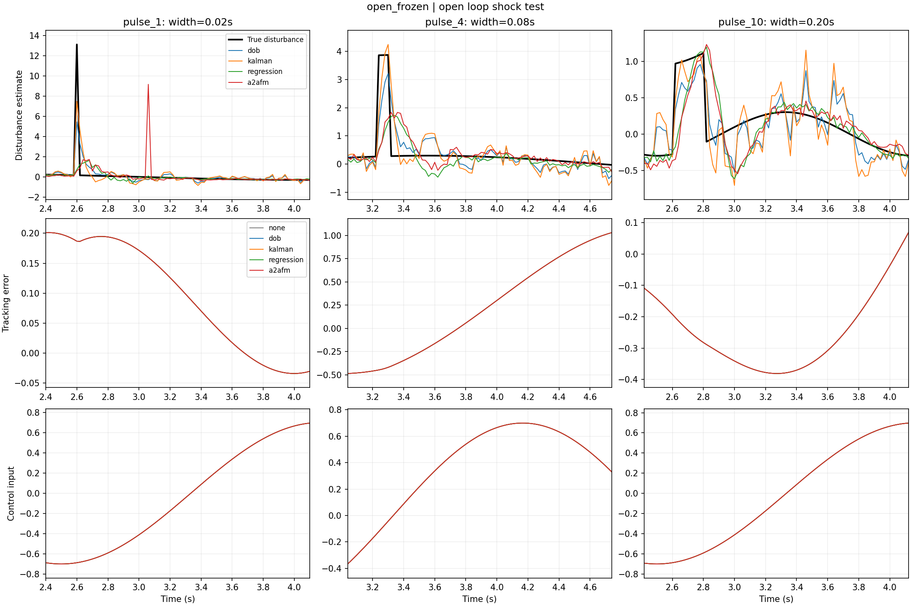
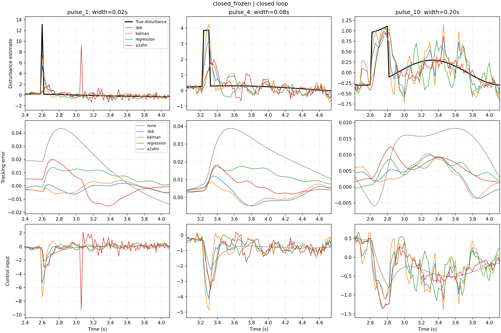
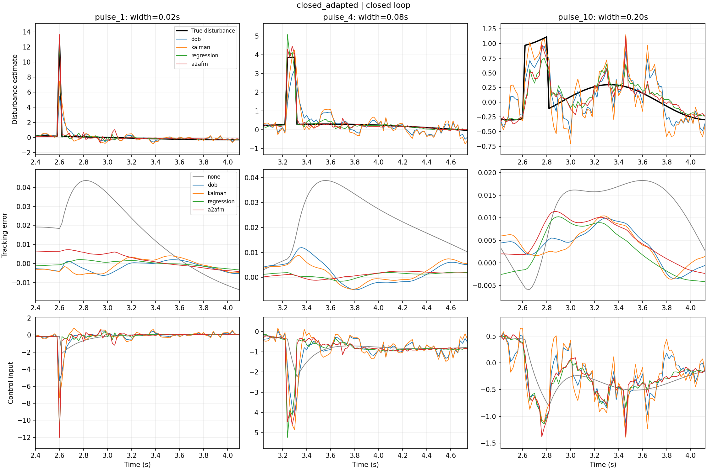

# 冲击扰动与闭环控制实验

原系统保持原样；副本位于 snapshots/open_loop_20261013_234542。闭环代码位于 closed_loop/。

## 控制器与观测器

`u_nom=c*v+kappa*x+m*(r_ddot+8*(r_dot-v)+16*(r-x))`，`u=clip(u_nom-clip(d_est,-12,12),-12,12)`。
参考为 `r=0.4*sin(2*pi*0.15*t)`。dt=0.02s，精确 ZOH 离散植物，控制及扰动在采样区间内保持常值。
采样顺序：读取旧控制 u[k-1] 下的加速度 -> 计算扰动残差 -> 更新观测器 -> 计算新控制 u[k] -> 推进植物。不存在控制/加速度的代数循环。
所有方法在第24个采样点开始补偿；此前保持相同PD控制。无额外模拟计算延迟，属于同步采样控制仿真。

DOB：`d_est[k]=(1-alpha)*d_est[k-1]+alpha*d_hat[k]`，`alpha=1-exp(-omega*dt)`，验证选择 omega=24.0 rad/s。这是有加速度传感器的残差 Q 滤波 DOB，不对噪声位置作两次数值微分。
Kalman：增广扰动状态 `[d,d_dot]`，常速度转移；测量 d_hat；验证选择过程驱动方差 q=100000.0，R=(m*sigma_a)^2。
神经网络：保留原过去→未来FM和直接回归结构，只用首项扰动估计。经典方法使用d_hat；网络也使用x/v/u/系统参数。
参数只按12条验证轨迹的 `tracking_RMSE²+1e-5*Δu_RMS²` 选择，未用测试集调参。

## 冲击定义与数据

测试包含平滑扰动及 0.02/0.08/0.20 秒矩形脉冲，每条冲击轨迹包含一正一负冲击，出现时间随机。
每次冲量绝对值 J∈[0.15,0.35]，幅值为 J/width，叠加小幅正弦背景。宽度相同的试验在各方法间共享参数、参考与噪声序列。
这是有限宽度脉冲；单周期脉冲也不是数学 Dirac δ。采样区间内定义为常值，所以窄脉冲不会被积分器遗漏。
每个阶段24条测试轨迹（每类6条），高斯加速度噪声σ=0.5。原权重冻结迁移与闭环新权重分别报告。

## 汇总指标

下表先按训练种子平均每条轨迹的MSE，再跨轨迹开方；不是把三个种子当成72条独立测试轨迹。none为无补偿参照，不算四种观测器之一。
冲击RMSE只统计脉冲持续区间，避免短冲击被长时间背景掩盖。

| 阶段 | 方法 | 扰动RMSE | 冲击区间RMSE | 跟踪RMSE | 控制RMS | Δu RMS |
|---|---|---:|---:|---:|---:|---:|
| open_frozen | none | 0.50547 | 7.89193 | 0.43034 | 0.48584 | 0.01900 |
| open_frozen | dob | 0.37825 | 4.84040 | 0.43034 | 0.48584 | 0.01900 |
| open_frozen | kalman | 0.40990 | 3.73418 | 0.43034 | 0.48584 | 0.01900 |
| open_frozen | regression | 0.45131 | 7.37100 | 0.43034 | 0.48584 | 0.01900 |
| open_frozen | a2afm | 0.53113 | 7.59340 | 0.43034 | 0.48584 | 0.01900 |
| closed_frozen | none | 0.50547 | 7.89193 | 0.01121 | 0.52367 | 0.07092 |
| closed_frozen | dob | 0.37825 | 4.84040 | 0.00478 | 0.61788 | 0.28829 |
| closed_frozen | kalman | 0.40990 | 3.73418 | 0.00477 | 0.68350 | 0.39544 |
| closed_frozen | regression | 0.51595 | 7.40558 | 0.00532 | 0.62495 | 0.22798 |
| closed_frozen | a2afm | 0.54582 | 7.61332 | 0.00496 | 0.64644 | 0.49394 |
| closed_adapted | none | 0.50547 | 7.89193 | 0.01121 | 0.52367 | 0.07092 |
| closed_adapted | dob | 0.37825 | 4.84040 | 0.00478 | 0.61788 | 0.28829 |
| closed_adapted | kalman | 0.40990 | 3.73418 | 0.00477 | 0.68350 | 0.39544 |
| closed_adapted | regression | 0.13951 | 1.54308 | 0.00323 | 0.64421 | 0.50433 |
| closed_adapted | a2afm | 0.13325 | 1.06708 | 0.00312 | 0.63941 | 0.49033 |

## 指标解释与适用范围

- open_frozen阶段控制不使用估计，所以跟踪/控制指标在方法间相同，只比较去噪；closed_frozen比较旧权重迁移；closed_adapted比较新闭环数据训练权重。
- 原权重未见过冲击及反馈控制输入。不能把旧模型的迁移失败直接归结为FM方法本身；也不能用新模型成绩宣称旧模型无需训练即可泛化。
- 新模型训练使用72条独立轨迹，含平滑和三种宽度冲击，混合无补偿PD与DOB采集；验证/测试轨迹独立。
- 恢复时间从脉冲结束起计算，在2秒观察窗口内寻找位置误差连续0.5秒保持在±0.02内的起点；未恢复比例单列在CSV。未恢复不会被写成0秒。
- 脉冲起点对齐采样网格，不包含异步或亚采样宽度冲击；这不是对真实Dirac冲量的测试。
- CSV同时给出峰值误差、饱和比例、冲击峰值估计比和脉冲区间积分误差。峰值比包含正弦背景，不是严格的纯脉冲增益。
- 控制输入和补偿统一限幅12；估计器原始输出不截断后再评分，避免隐藏不良估计。
- 当前已知精确x/v和系统参数；数值试验不能证明神经网络闭环全局稳定性，也未覆盖参数失配和传感器延时。
- 无补偿线性离散闭环的标称极点已检查在单位圆内；完整含非线性限幅与神经观测器系统只报告实际仿真表现。

参考：[DOB综述](https://doi.org/10.1109/TIE.2015.2478397)；本实验采用可测加速度的残差Q滤波形式。

## open_frozen 示例

## closed_frozen 示例

## closed_adapted 示例

