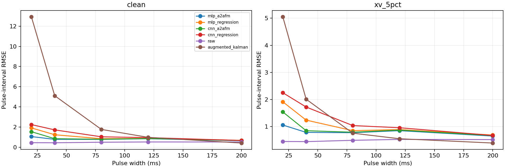
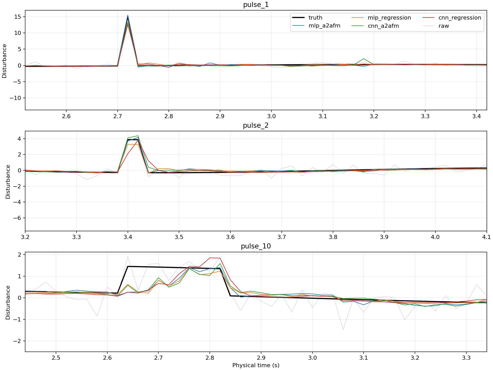

# CNN 与全连接 A2AFM：冲击扰动估计

训练：96条独立轨迹 × 2种测量条件；验证24条；测试72条。
四组模型均从头训练，种子[11, 22, 33]，每模型3000次更新；保持原FM桥接和4步中点积分。
训练/验证：平滑、20/80/200ms脉冲；测试另含未参与训练的40/120ms宽度。
两种测量条件：x/v准确和x/v联合5%高斯噪声；加速度噪声始终σ=0.5。
百分比相对于干净训练集固定通道标准差；同一真轨迹及测量噪声在各方法间共享。
训练、验证、测试均stride=1，包含所有单采样冲击；物理采样20ms，脉冲对齐采样网格。
独立数据种子为91000/92000/93000；每条冲击轨迹含正负各一次脉冲，冲量绝对值0.15–0.35。
CNN使用32通道、3个扩张因果卷积残差块（dilation=1/2/4），展平后80宽全连接读出；不是纯全卷积解码器。
卷积提取历史特征，读出层映射至未来坐标；窗口内没有未来实测信息。
同一种子共享训练批次顺序，两个FM模型还共享流时间抽样；每500步按两条件混合验证当前MSE选择最佳权重。
训练1线程/worker，最多3个独立种子同时执行；相同步数和近似参数量，不是等FLOPs或等墙钟时间。

## 汇总

先平均模型种子和轨迹的MSE再开方；冲击RMSE仅脉冲持续点，按轨迹等权，不让长脉冲主导。
背景排除脉冲及其后0.5秒；恢复区间误差统计这0.5秒。此处没有闭环控制。

| 测量条件 | 方法 | 全时段RMSE | 冲击RMSE | 背景RMSE | 冲击后RMSE |
|---|---|---:|---:|---:|---:|
| clean | raw | 0.50045 | 0.48340 | 0.49988 | 0.50852 |
| clean | ema | 0.36879 | 3.16902 | 0.28762 | 0.55043 |
| clean | augmented_kalman | 0.47226 | 6.28510 | 0.02441 | 1.02460 |
| clean | mlp_a2afm | 0.14575 | 0.82821 | 0.09669 | 0.25525 |
| clean | mlp_regression | 0.15422 | 1.19340 | 0.09909 | 0.21811 |
| clean | cnn_a2afm | 0.15972 | 0.98716 | 0.11376 | 0.24993 |
| clean | cnn_regression | 0.17529 | 1.44072 | 0.11464 | 0.22369 |
| xv_5pct | raw | 0.50151 | 0.48597 | 0.50094 | 0.50926 |
| xv_5pct | ema | 0.36915 | 3.16993 | 0.28801 | 0.55087 |
| xv_5pct | augmented_kalman | 0.41343 | 2.47325 | 0.35029 | 0.68857 |
| xv_5pct | mlp_a2afm | 0.15419 | 0.83210 | 0.10931 | 0.25698 |
| xv_5pct | mlp_regression | 0.16047 | 1.19684 | 0.10843 | 0.21996 |
| xv_5pct | cnn_a2afm | 0.16264 | 0.99028 | 0.11767 | 0.25041 |
| xv_5pct | cnn_regression | 0.17750 | 1.44561 | 0.11749 | 0.22473 |

## 按冲击宽度分组

| 条件 | 宽度 | 方法 | 冲击RMSE | 起点RMSE | 平均绝对积分误差 |
|---|---|---|---:|---:|---:|
| clean | 20ms | raw | 0.44696 | 0.44696 | 0.00704 |
| clean | 20ms | ema | 6.45542 | 6.45542 | 0.12503 |
| clean | 20ms | augmented_kalman | 12.93122 | 12.93122 | 0.25070 |
| clean | 20ms | mlp_a2afm | 1.05352 | 1.05352 | 0.01778 |
| clean | 20ms | mlp_regression | 1.91234 | 1.91234 | 0.03191 |
| clean | 20ms | cnn_a2afm | 1.53821 | 1.53821 | 0.02631 |
| clean | 20ms | cnn_regression | 2.24171 | 2.24171 | 0.03892 |
| clean | 40ms | raw | 0.43881 | 0.43747 | 0.00925 |
| clean | 40ms | ema | 2.66223 | 3.37725 | 0.09754 |
| clean | 40ms | augmented_kalman | 5.10476 | 6.60984 | 0.18496 |
| clean | 40ms | mlp_a2afm | 0.77690 | 0.74761 | 0.01749 |
| clean | 40ms | mlp_regression | 1.23526 | 0.90621 | 0.02737 |
| clean | 40ms | cnn_a2afm | 0.84209 | 0.91119 | 0.02250 |
| clean | 40ms | cnn_regression | 1.71611 | 1.51072 | 0.03207 |
| clean | 80ms | raw | 0.49179 | 0.54257 | 0.01701 |
| clean | 80ms | ema | 0.97609 | 1.62576 | 0.06050 |
| clean | 80ms | augmented_kalman | 1.76350 | 3.21059 | 0.09979 |
| clean | 80ms | mlp_a2afm | 0.77329 | 1.12316 | 0.03462 |
| clean | 80ms | mlp_regression | 0.84043 | 1.32854 | 0.03646 |
| clean | 80ms | cnn_a2afm | 0.78769 | 1.14362 | 0.03111 |
| clean | 80ms | cnn_regression | 1.03135 | 1.63472 | 0.04813 |
| clean | 120ms | raw | 0.51879 | 0.46318 | 0.02303 |
| clean | 120ms | ema | 0.60846 | 1.12838 | 0.04121 |
| clean | 120ms | augmented_kalman | 0.97805 | 2.17939 | 0.06761 |
| clean | 120ms | mlp_a2afm | 0.84090 | 1.26306 | 0.05871 |
| clean | 120ms | mlp_regression | 0.87649 | 1.35361 | 0.05681 |
| clean | 120ms | cnn_a2afm | 0.85985 | 1.24867 | 0.06168 |
| clean | 120ms | cnn_regression | 0.94993 | 1.46927 | 0.07771 |
| clean | 200ms | raw | 0.51483 | 0.47526 | 0.02911 |
| clean | 200ms | ema | 0.36150 | 0.64994 | 0.03362 |
| clean | 200ms | augmented_kalman | 0.41351 | 1.18957 | 0.03653 |
| clean | 200ms | mlp_a2afm | 0.64116 | 1.06032 | 0.09981 |
| clean | 200ms | mlp_regression | 0.68086 | 1.09197 | 0.10133 |
| clean | 200ms | cnn_a2afm | 0.66141 | 1.02974 | 0.10221 |
| clean | 200ms | cnn_regression | 0.66488 | 1.07865 | 0.10250 |
| xv_5pct | 20ms | raw | 0.44765 | 0.44765 | 0.00707 |
| xv_5pct | 20ms | ema | 6.45824 | 6.45824 | 0.12510 |
| xv_5pct | 20ms | augmented_kalman | 5.05236 | 5.05236 | 0.09721 |
| xv_5pct | 20ms | mlp_a2afm | 1.05538 | 1.05538 | 0.01777 |
| xv_5pct | 20ms | mlp_regression | 1.91217 | 1.91217 | 0.03190 |
| xv_5pct | 20ms | cnn_a2afm | 1.53858 | 1.53858 | 0.02628 |
| xv_5pct | 20ms | cnn_regression | 2.24792 | 2.24792 | 0.03902 |
| xv_5pct | 40ms | raw | 0.44318 | 0.44313 | 0.00919 |
| xv_5pct | 40ms | ema | 2.66092 | 3.37761 | 0.09748 |
| xv_5pct | 40ms | augmented_kalman | 2.00889 | 2.80362 | 0.05943 |
| xv_5pct | 40ms | mlp_a2afm | 0.78409 | 0.75928 | 0.01755 |
| xv_5pct | 40ms | mlp_regression | 1.23720 | 0.91207 | 0.02735 |
| xv_5pct | 40ms | cnn_a2afm | 0.84642 | 0.91652 | 0.02275 |
| xv_5pct | 40ms | cnn_regression | 1.72059 | 1.52819 | 0.03218 |
| xv_5pct | 80ms | raw | 0.49050 | 0.54336 | 0.01676 |
| xv_5pct | 80ms | ema | 0.97585 | 1.62558 | 0.06043 |
| xv_5pct | 80ms | augmented_kalman | 0.75418 | 1.30831 | 0.01963 |
| xv_5pct | 80ms | mlp_a2afm | 0.77201 | 1.12371 | 0.03435 |
| xv_5pct | 80ms | mlp_regression | 0.84715 | 1.34876 | 0.03616 |
| xv_5pct | 80ms | cnn_a2afm | 0.79022 | 1.15467 | 0.03067 |
| xv_5pct | 80ms | cnn_regression | 1.03543 | 1.64250 | 0.04783 |
| xv_5pct | 120ms | raw | 0.52462 | 0.48002 | 0.02267 |
| xv_5pct | 120ms | ema | 0.60615 | 1.12203 | 0.04115 |
| xv_5pct | 120ms | augmented_kalman | 0.54903 | 0.88839 | 0.01841 |
| xv_5pct | 120ms | mlp_a2afm | 0.84732 | 1.25353 | 0.05930 |
| xv_5pct | 120ms | mlp_regression | 0.88764 | 1.35505 | 0.05782 |
| xv_5pct | 120ms | cnn_a2afm | 0.86698 | 1.24580 | 0.06282 |
| xv_5pct | 120ms | cnn_regression | 0.95600 | 1.46066 | 0.07827 |
| xv_5pct | 200ms | raw | 0.51791 | 0.47159 | 0.02884 |
| xv_5pct | 200ms | ema | 0.36481 | 0.65478 | 0.03369 |
| xv_5pct | 200ms | augmented_kalman | 0.39075 | 0.58268 | 0.02121 |
| xv_5pct | 200ms | mlp_a2afm | 0.64759 | 1.07170 | 0.10009 |
| xv_5pct | 200ms | mlp_regression | 0.68522 | 1.09328 | 0.10161 |
| xv_5pct | 200ms | cnn_a2afm | 0.66601 | 1.03466 | 0.10197 |
| xv_5pct | 200ms | cnn_regression | 0.67035 | 1.09153 | 0.10252 |

## 配对统计

对各训练种子MSE平均，再在每种波形内按轨迹配对重采样5000次。正差值代表CNN A2AFM更好；未作多重比较校正。

| 条件 | 指标 | 对照 | 对照减CNN A2AFM | 95%区间 |
|---|---|---|---:|---|
| clean | rmse | mlp_a2afm | -0.01397 | [-0.01611, -0.01178] |
| clean | rmse | mlp_regression | -0.00550 | [-0.00787, -0.00316] |
| clean | rmse | cnn_regression | 0.01557 | [0.01206, 0.01910] |
| clean | rmse | raw | 0.34073 | [0.32837, 0.35319] |
| clean | rmse | augmented_kalman | 0.31255 | [0.28995, 0.33369] |
| clean | shock_rmse | mlp_a2afm | -0.15895 | [-0.20874, -0.11120] |
| clean | shock_rmse | mlp_regression | 0.20624 | [0.14444, 0.26880] |
| clean | shock_rmse | cnn_regression | 0.45356 | [0.36024, 0.54196] |
| clean | shock_rmse | raw | -0.50376 | [-0.58967, -0.42183] |
| clean | shock_rmse | augmented_kalman | 5.29794 | [4.95316, 5.60758] |
| xv_5pct | rmse | mlp_a2afm | -0.00845 | [-0.01049, -0.00635] |
| xv_5pct | rmse | mlp_regression | -0.00217 | [-0.00448, 0.00015] |
| xv_5pct | rmse | cnn_regression | 0.01486 | [0.01132, 0.01844] |
| xv_5pct | rmse | raw | 0.33887 | [0.32643, 0.35177] |
| xv_5pct | rmse | augmented_kalman | 0.25079 | [0.24173, 0.25960] |
| xv_5pct | shock_rmse | mlp_a2afm | -0.15819 | [-0.20848, -0.10993] |
| xv_5pct | shock_rmse | mlp_regression | 0.20656 | [0.14234, 0.26470] |
| xv_5pct | shock_rmse | cnn_regression | 0.45533 | [0.35876, 0.53984] |
| xv_5pct | shock_rmse | raw | -0.50431 | [-0.59341, -0.41922] |
| xv_5pct | shock_rmse | augmented_kalman | 1.48297 | [1.32480, 1.63709] |

## 在线计算延迟

训练worker退出后测量，2线程、batch=1、30次预热、两条完整测试流。包括历史更新/残差/归一化/模型/输出，不含传感器和执行器。

| 方法 | 参数量 | 中位ms | P95ms | P99ms | 最大ms | 超20ms比例 |
|---|---:|---:|---:|---:|---:|---:|
| mlp_a2afm | 86296 | 0.909 | 1.264 | 2.060 | 6.572 | 0.0000 |
| mlp_regression | 82712 | 0.167 | 0.303 | 0.433 | 19.744 | 0.0000 |
| cnn_a2afm | 82888 | 4.856 | 6.040 | 8.105 | 18.345 | 0.0000 |
| cnn_regression | 82728 | 0.637 | 0.996 | 2.387 | 7.008 | 0.0000 |

## 曲线

## 限制与复现

- 训练见过冲击，40/120ms是未见宽度的插值测试，不是完全零样本冲击泛化。
- 仍为已知准确系统参数、有限宽脉冲、同步采样和开环估计，不是Dirac冲量或闭环性能证明。
- 主评分因未来标签长度而省略末23个点，冲击全部位于有效区间；背景样本不包含启动窗口。
- 传统方法EMA/增广Kalman每个测量条件独立验证调参，知道传感器噪声方差；神经模型共享两条件权重。
- CNN增加了卷积计算；参数相近不代表计算量相近。测得延迟不构成实时截止时间保证。
- 初始流仍为原始历史残差，未修改此前讨论的重尾起点问题；本轮没有重尾噪声。
- 复现命令见 ../../cnn_experiment/README.md；配置、划分、权重、观测、预测和源码摘要均归档。
