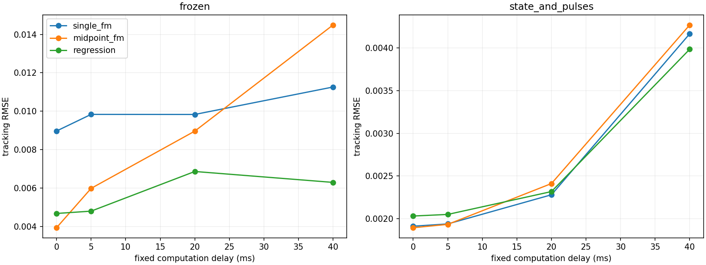

# 计算延时下的闭环复核

本实验与适配主实验分离，使用冻结权重与加入冲击适配后的权重，不在有延时仿真中再次训练或选模型。
## 延时如何进入动力学

在t_k采集观测并开始计算，t_k+δ才施加新控制。期间旧控制量继续驱动系统。δ小于20ms时，将同一采样区间分成两段，分别使用旧/新控制量进行精确ZOH推进。δ等于或超过周期时，单个计算工作线程在忙碌采样点跳过新任务，持续采集历史；不排队、不抢占，完成后在下一采样点启动新任务。
采样边界恰好完成的任务在本次采样后生效，再允许启动新计算；这与原零延时实现的“先测量、再施加控制”顺序一致。前23个点为共同理想PD热身，之后开始施加延时。
## 软件耗时测量

本地CPU、batch=1、30次预热后测300次，测量公开estimate API和PD控制算术，包含输入检查、归一化、网络推理、反归一化与控制限幅；不包含传感器/执行器I/O、通信、操作系统调度或真实硬件抖动。各模型和种子单独测量。
measured_p50/measured_p95使用对应分位数作为恒定软件计算延时；P95不是硬件最坏执行时间保证。另外统一施加5/20/40ms延时做敏感性测试。仿真批计算只为加速独立轨迹计算，不把24个系统的批吞吐冒充单系统延时。
与适配主实验使用同一独立冲击测试规格seed150000、24条轨迹。所有测量在适配训练结束后进行。

| 权重 | 方法 | 延时条件 | 平均延时(ms) | 跟踪RMSE | 跳过任务比例 | 饱和时间比例 |
|---|---|---|---:|---:|---:|---:|
| frozen | single_fm | zero | 0.0000 | 0.00897 | 0.000 | 0.0001 |
| frozen | single_fm | measured_p50 | 0.1086 | 0.00899 | 0.000 | 0.0001 |
| frozen | single_fm | measured_p95 | 0.1275 | 0.00900 | 0.000 | 0.0001 |
| frozen | single_fm | fixed_5ms | 5.0000 | 0.00984 | 0.000 | 0.0001 |
| frozen | single_fm | fixed_20ms | 20.0000 | 0.00983 | 0.000 | 0.0000 |
| frozen | single_fm | fixed_40ms | 40.0000 | 0.01126 | 0.500 | 0.0000 |
| frozen | midpoint_fm | zero | 0.0000 | 0.00394 | 0.000 | 0.0000 |
| frozen | midpoint_fm | measured_p50 | 0.6527 | 0.00419 | 0.000 | 0.0000 |
| frozen | midpoint_fm | measured_p95 | 0.7332 | 0.00422 | 0.000 | 0.0000 |
| frozen | midpoint_fm | fixed_5ms | 5.0000 | 0.00598 | 0.000 | 0.0000 |
| frozen | midpoint_fm | fixed_20ms | 20.0000 | 0.00896 | 0.000 | 0.0000 |
| frozen | midpoint_fm | fixed_40ms | 40.0000 | 0.01449 | 0.500 | 0.0000 |
| frozen | regression | zero | 0.0000 | 0.00468 | 0.000 | 0.0000 |
| frozen | regression | measured_p50 | 0.0927 | 0.00469 | 0.000 | 0.0000 |
| frozen | regression | measured_p95 | 0.1015 | 0.00469 | 0.000 | 0.0000 |
| frozen | regression | fixed_5ms | 5.0000 | 0.00480 | 0.000 | 0.0000 |
| frozen | regression | fixed_20ms | 20.0000 | 0.00686 | 0.000 | 0.0000 |
| frozen | regression | fixed_40ms | 40.0000 | 0.00630 | 0.500 | 0.0000 |
| state_and_pulses | single_fm | zero | 0.0000 | 0.00191 | 0.000 | 0.0002 |
| state_and_pulses | single_fm | measured_p50 | 0.1091 | 0.00191 | 0.000 | 0.0002 |
| state_and_pulses | single_fm | measured_p95 | 0.1160 | 0.00191 | 0.000 | 0.0002 |
| state_and_pulses | single_fm | fixed_5ms | 5.0000 | 0.00194 | 0.000 | 0.0002 |
| state_and_pulses | single_fm | fixed_20ms | 20.0000 | 0.00228 | 0.000 | 0.0002 |
| state_and_pulses | single_fm | fixed_40ms | 40.0000 | 0.00417 | 0.500 | 0.0002 |
| state_and_pulses | midpoint_fm | zero | 0.0000 | 0.00189 | 0.000 | 0.0003 |
| state_and_pulses | midpoint_fm | measured_p50 | 0.6544 | 0.00190 | 0.000 | 0.0003 |
| state_and_pulses | midpoint_fm | measured_p95 | 0.7336 | 0.00190 | 0.000 | 0.0003 |
| state_and_pulses | midpoint_fm | fixed_5ms | 5.0000 | 0.00193 | 0.000 | 0.0003 |
| state_and_pulses | midpoint_fm | fixed_20ms | 20.0000 | 0.00241 | 0.000 | 0.0003 |
| state_and_pulses | midpoint_fm | fixed_40ms | 40.0000 | 0.00427 | 0.500 | 0.0003 |
| state_and_pulses | regression | zero | 0.0000 | 0.00203 | 0.000 | 0.0000 |
| state_and_pulses | regression | measured_p50 | 0.0927 | 0.00203 | 0.000 | 0.0000 |
| state_and_pulses | regression | measured_p95 | 0.0997 | 0.00203 | 0.000 | 0.0000 |
| state_and_pulses | regression | fixed_5ms | 5.0000 | 0.00205 | 0.000 | 0.0000 |
| state_and_pulses | regression | fixed_20ms | 20.0000 | 0.00232 | 0.000 | 0.0000 |
| state_and_pulses | regression | fixed_40ms | 40.0000 | 0.00399 | 0.500 | 0.0000 |

RMSE先平均种子及轨迹的MSE再开方。控制RMS/饱和时间在旧/新控制的分段区间上积分，不将尚未完成计算的新控制提前作用于植物。
## 解释范围

实测软件延时若远小于20ms，单步计算更快不一定转化为显著跟踪优势。固定延时敏感性只说明当前控制器在指定调度策略下的表现，不能替代真实硬件实时性测量。尚未模拟网络传输、随机调度抖动、并行控制任务或延时补偿控制器。

```powershell
.\.venv\Scripts\python.exe -m unittest test_delayed -v
.\.venv\Scripts\python.exe delay_experiment.py
```


