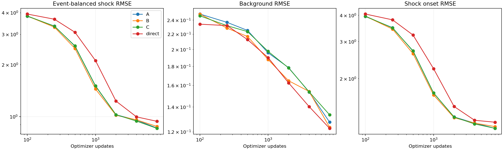
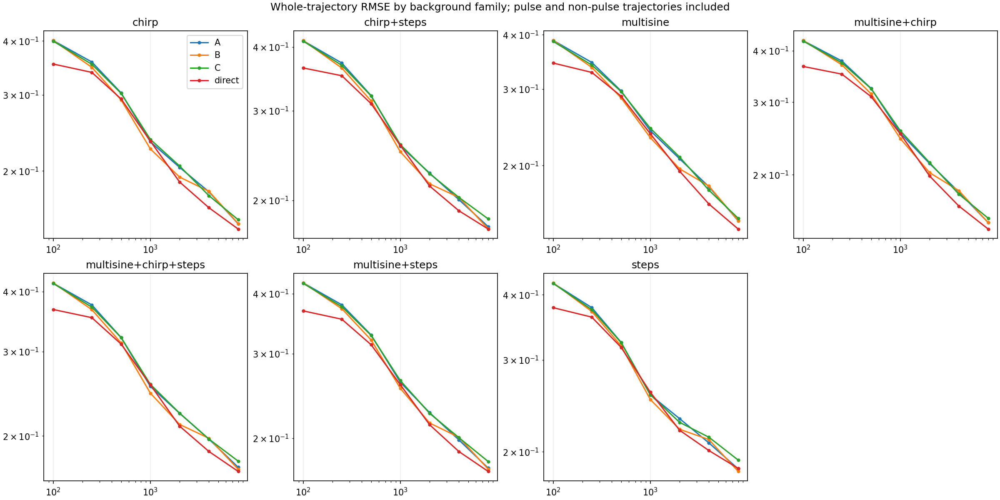

# FM 流损失是否加快早期学习

完成日期 2026-11-08。

本轮观察到 FM 辅助速度损失在相同更新次数下带来小幅、集中于早期的改善。相对同构残差回归，100–2000 次更新间的冲击误差曲线平均改善 1.66%，97.5% 配对层级 bootstrap 区间为 [1.07%,2.26%]。相对端点加权对照改善 1.85%，区间为 [1.31%,2.35%]。背景曲线也分别改善 3.48% 和 2.72%。这些数值支持本配置下的小幅早期收益，幅度低于原先采用的 10% 工程参照。

相对普通直接回归，FM 的早期冲击曲线改善 14.75%。同构残差回归本身已获得其中很大部分收益。相近优化耗时比较中，同构残差回归表现更好，说明 FM 每次更新的额外计算需要纳入选择。

## 实验安排

三套全新独立训练数据，每套360条训练和144条验证，分别使用三个配对权重种子。共同测试集720条，其中120条无新增脉冲，600条有两个脉冲，合计1200个事件。训练、验证、测试及历史实验使用不同数据种子。所有训练使用本地CPU，三个进程，每进程PyTorch单线程。

| 模型 | 结构与部署 | 损失 | 每次更新前向次数 |
|---|---|---|---:|
| A | 同构残差，86296参数，单次部署调用 | 结果损失 | 1 |
| B | 与A完全相同 | 结果损失 + FM速度损失 | 2 |
| C | 与A完全相同 | 结果损失 + 重复端点整段误差 | 2 |
| direct | 普通直接回归，82712参数，单次部署调用 | 结果损失 | 1 |

A/B/C使用相同初始权重、批次、训练源增强及优化器设置。随机tau独立于批次和增强随机流。C的辅助项在数学上等于额外一份整段结果MSE，此次使用第二次求值以匹配B的前向次数。direct的结构与输出参数化不同，因此B/A和B/C用于辨别流损失作用。

所有模型从头训练。结果损失为整段MSE加4倍当前点MSE。B速度损失权重为1，沿随机线性插值路径监督目标y−s。AdamW学习率0.001、batch128、梯度裁剪5，归一化source白噪声标准差0.01。

预算固定100、250、500、1000、2000、4000、8000次优化更新。每个预算保存该步的精确权重，训练结束后统一评分。验证只记录诊断值，不选择权重。每套有199800个窗口，约1561次更新相当于一次等量有放回抽样，所以1000步约0.64轮，8000步约5.13轮。

背景覆盖正弦、chirp、阶跃、三种两两混合以及三者混合。训练脉冲宽度20/80/200ms，测试另含40/120ms。两种幅值制度分别为固定冲量范围|J|=0.15–0.35，以及独立幅值|A|=0.5–3。观测输入为准确x/v、已知参数和带噪加速度。

主测试高斯噪声sigma=0.5。另在1000和8000步测试高斯0.2、0.9及同方差Student-t(3)。各方法在同一PD/DOB回放上做影子估计。这里评估固定观测流中的学习效率，闭环收益需要额外验证。

## 相同更新数的结果

以下数值先分别计算9个训练重复的事件/宽度等权冲击RMSE，再取均值。

| 更新数 | A残差回归 | B单步FM | C端点加权 | 普通直接回归 | B对A改善 |
|---|---:|---:|---:|---:|---:|
| 100 | 3.8128 | 3.8279 | 3.8298 | 3.9292 | −0.40% |
| 250 | 3.3479 | 3.2975 | 3.3404 | 3.6671 | 1.50% |
| 500 | 2.5570 | 2.4830 | 2.5680 | 3.0819 | 2.89% |
| 1000 | 1.5018 | 1.4448 | 1.5090 | 2.1123 | 3.79% |
| 2000 | 1.0257 | 1.0191 | 1.0261 | 1.2301 | 0.65% |
| 4000 | 0.9547 | 0.9574 | 0.9422 | 0.9967 | −0.29% |
| 8000 | 0.8582 | 0.8770 | 0.8549 | 0.9394 | −2.19% |

1000步时，B对direct改善约31.6%，对A改善3.79%。这回答了两个不同层次的问题。完整FM方案相对直接输出的回归器有明显早期冲击收益，而通过相同结构对照识别出的FM辅助项收益较小。训练继续到4000–8000步，B对A的优势消失。



## 整段早期曲线统计

主要终点在训练配置中预先定义为100–2000更新间沿log更新数积分的冲击RMSE平均值，覆盖五个固定预算。该指标降低挑选单个有利训练步数的影响。

| B相对对照 | 冲击曲线改善 | 区间 | 背景曲线变化 |
|---|---:|---|---|
| A | 1.66% | 97.5%区间 [1.07%,2.26%] | 改善3.48% |
| C | 1.85% | 97.5%区间 [1.31%,2.35%] | 改善2.72% |
| direct | 14.75% | 探索性95%区间 [13.01%,16.50%] | 恶化0.97% |

bootstrap进行5000次，配对重采样独立训练数据、其中的权重种子及共同测试轨迹。两个FM机制比较使用各97.5%区间。外层只有3套训练数据，区间应连同这个规模限制解读。逐预算与逐宽度分析属于探索性。

## 加入计算时间后

每个配对运行取四种方法共有的早期优化耗时范围，在log耗时上插值比较冲击曲线面积。面积越低越好。

| 方法 | 平均面积 |
|---|---:|
| A | 2.36272 |
| B | 2.72979 |
| C | 2.77762 |
| direct | 2.77105 |

B相对A的面积高约15.5%。增加FM辅助项后，每次更新多一次网络前向和相应反向计算，小幅更新效率收益尚未转化为本次CPU上的计算效率收益。

这是基于实际计时和离散曲线插值的探索性比较。计时包括前向、反向、梯度裁剪和优化器更新，公共抽样、验证和磁盘保存不计入。并行CPU调度也影响耗时。它提供资源代价的线索，严格的固定墙钟停止实验还需单独设计。

## 优势集中在哪些扰动

1000步时，两种短脉冲制度的差异很大。

| 冲击条件 | A | B | C | direct |
|---|---:|---:|---:|---:|
| 固定冲量，20ms | 3.8886 | 3.6774 | 3.9312 | 5.9749 |
| 固定冲量，40ms | 1.2573 | 1.1640 | 1.2068 | 1.7991 |
| 独立幅值，20ms | 1.2540 | 1.2795 | 1.2471 | 1.1919 |
| 独立幅值，40ms | 1.0073 | 1.0260 | 1.0106 | 0.9760 |

固定冲量的20ms脉冲幅值为7.5–17.5，独立幅值组为0.5–3。B的正向收益主要出现在前一种高幅短脉冲。低幅短脉冲中B稍差。因此证据更接近“部分高幅短脉冲更早学好”，不能概括成所有冲击统一占优。总体采用绝对误差MSE，数值较大的事件对结果仍有更大影响，即使分层已经等权。

在背景去噪方面，1000步时B相对A在七个信号族都略好。例子如下。

| 背景信号族 | A | B | direct |
|---|---:|---:|---:|
| 正弦 | 0.19095 | 0.18088 | 0.18502 |
| chirp | 0.17838 | 0.16906 | 0.17240 |
| 阶跃 | 0.20599 | 0.20073 | 0.20066 |
| 三者混合 | 0.20342 | 0.19512 | 0.19720 |

背景指标剔除新增脉冲及其后0.5秒，保留背景本身的阶跃变化。阶跃族中B与direct几乎相同。这里没有单独对持续阶跃起点和平台期做速度判定。



## 噪声复测与历史结果的关系

1000步时，在高斯0.2、高斯0.9和Student-t噪声下，B的冲击误差都略低于A，明显低于direct。到8000步，B对A均转为略差。完整数字见[TABLES.md](TABLES.md)。

早期收益与上一轮较充分训练后未观察到明显FM机制收益相容。两次实验回答的训练阶段不同。这次在全新数据上保存早期权重，支持小幅短期优化帮助，但没有显示这种帮助能持续累积，也没有证明更少实际计算就能达到相同质量。

## 产物与复现

- 252个预算检查点，所有步骤、同构初始化哈希、参数量、有限权重及源哈希核验通过。
- 468组评估，保存逐轨迹指标。720条物理测试轨迹的不同噪声版本共享外生规格，统计不把它们当作独立物理重复。
- 训练1080条、验证432条、测试720条，完整轨迹ID隔离检查通过。
- 复用的10项配对采样、损失等价、事件权重及因果性测试通过。
- 原始权重、曲线、统计、运行日志和配置均保存在本目录，恢复优化器缓存被git忽略。

```powershell
.venv/Scripts/python.exe learning_speed_experiment.py --out results/learning_speed_new
.venv/Scripts/python.exe analyze_learning_speed.py --out results/learning_speed_new
```

协议见[LEARNING_SPEED_PROTOCOL.md](../../LEARNING_SPEED_PROTOCOL.md)，逐信号族和逐脉冲宽度记录见subgroups.json。训练源文件在frozen.json中记录哈希，复用目录时会校验配置和来源。更多学习率、FM权重、含噪x/v和闭环训练效率均可改变结果，目前结论适用于本轮固定配置。
