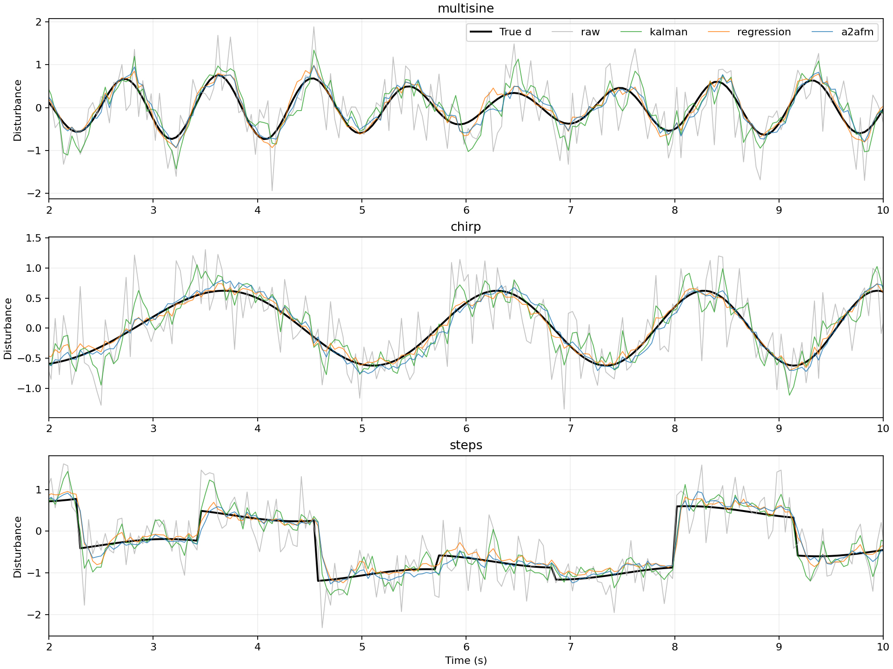
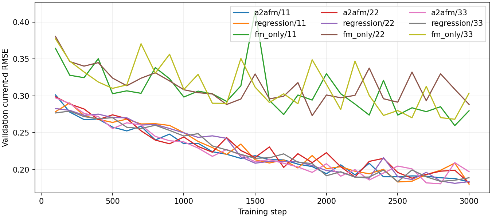

# 实验结果

生成时间：2026-10-13T23:15:45.147078+08:00

设备：cpu；训练轨迹 72；验证轨迹 18；每场景测试轨迹 24；随机种子 [11, 22, 33]。
窗口 L=24，dt=0.02 s；训练 3000 steps/model；中点积分 4 步。

## 当前扰动 d(t) 的测试 RMSE

| 方法 | Gaussian 0.2 | Gaussian 0.5 | Gaussian 0.9 | Student-t OOD 0.5 |
|---|---:|---:|---:|---:|
| raw | 0.19629 | 0.49073 | 0.88331 | 0.51480 |
| ema | 0.19581 | 0.24880 | 0.35153 | 0.24567 |
| local_poly | 0.14595 | 0.29909 | 0.52075 | 0.31233 |
| kalman | 0.13054 | 0.26573 | 0.41833 | 0.27510 |
| physics_backward | 0.03944 | 0.03944 | 0.03944 | 0.03944 |
| a2afm | 0.13166 ± 0.00866 | 0.15951 ± 0.00340 | 0.20818 ± 0.00320 | 0.22595 ± 0.00301 |
| regression | 0.14024 ± 0.00452 | 0.16153 ± 0.00418 | 0.20423 ± 0.00492 | 0.16321 ± 0.00406 |
| fm_only | 0.18850 ± 0.00533 | 0.22788 ± 0.00301 | 0.31418 ± 0.00116 | 0.25892 ± 0.00788 |

中等高斯噪声下，A2AFM 相对原始估计的 RMSE 降低 67.50%。

表中 ± 为训练随机种子间样本标准差，不是置信区间；各方法共享测试轨迹。
滤波方法按验证集调参；神经网络按验证当前时刻 RMSE 选择检查点。完整分信号指标见 metrics.csv，逐轨迹指标见 trajectory_metrics.csv。

## 必须保留的解释
- 这是 A2A 思想的信号空间改编，不是原机器人任务的复现；不存在隐空间编码/解码。
- 网络仅使用截至 t 的观测，未来 d 只作训练标签。测试时返回整段预测，但应用只取首项。
- 精确 x/v 的假设使 physics_backward 基线特别强；它使用相同可用信息。不能据此宣称 FM 优于物理方法。
- EMA、局部多项式、Kalman 只使用 d_hat；神经网络额外使用 x/v/u/A，须区分信息量差异。
- Student-t 为未训练噪声分布；阶跃属于训练中出现的信号族，不能称为信号族 OOD。
- 仿真真值来自已知方程；尚无真实传感器数据，未测试系统模型失配或 x/v 含噪。

