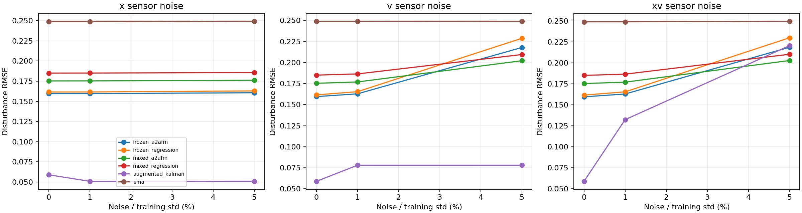
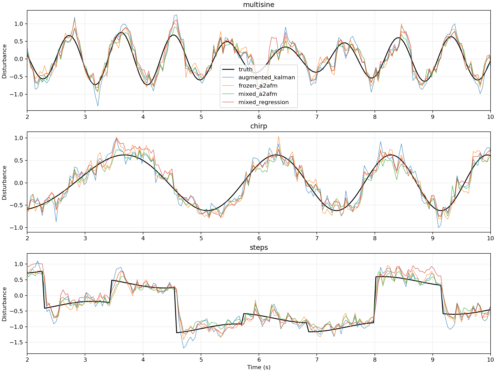

# 多通道测量噪声实验

完成时间（UTC）：2026-10-16T10:01:33.477598+00:00

Python 3.12.14，PyTorch 2.5.1+cpu，CPU；每个新模型训练 3000 步，训练种子 [11, 22, 33]。
原始独立轨迹：训练 72、验证 18、测试 24。
训练/验证加速度噪声沿用原实验的 Gaussian σ∈[0.2,0.9]；测试固定 Gaussian σ=0.5。
仅从干净训练轨迹计算固定尺度：std(x)=0.46268325，std(v)=0.57952589。
百分比乘以上述固定尺度得到传感器噪声的绝对标准差，不按测试轨迹重新缩放。

## 协议

- 原模型 frozen：加载 results/main 中已有 3000 步训练检查点，保持冻结。
- 新模型 mixed：每条训练轨迹生成以下七种观测版本；统一训练一个多噪声模型，而不是每个场景单独调模型。
- 七种版本共享物理轨迹与加速度测量；同一轨迹的位置/速度噪声标准正态抽样跨场景配对。
- 共 7 倍观测版本，不是 7 倍独立轨迹；固定噪声实现，不是每个 epoch 在线重新采样。
- 新模型仍是同一 A2AFM/回归结构、损失和超参数；验证按七种场景的混合当前扰动 MSE 选择检查点。
- 训练窗口 stride=2，验证 stride=8，测试 stride=2；每窗 24 点。所有测试方法使用相同有效时刻。
- 同一份带噪 x/v 同时用于条件与物理残差，真值和真实动力学不受噪声污染。
- 这是开环估计实验；控制输入维持原脚本定义，没有测试带噪状态反馈控制、延迟或重尾传感器噪声。
- augmented_kalman 使用 [x,v,d,d_dot] 状态和 [x_m,v_m,a_m] 测量，已知真实模型及传感器噪声方差。
- EMA 与增广 Kalman 为每个场景分别按独立验证集调参；新神经模型在场景间共享权重。
- Kalman 扰动采用局部线性变化先验；实际阶跃/多正弦不严格满足它，预测按上一采样输入作零阶保持近似。
- physics_backward 对带噪速度直接后向差分，是噪声敏感性参照，不代表最优物理估计器。

## 传感器噪声标准差

| 场景 | σx | σv |
|---|---:|---:|
| clean | 0.00000000 | 0.00000000 |
| x_1pct | 0.00462683 | 0.00000000 |
| v_1pct | 0.00000000 | 0.00579526 |
| xv_1pct | 0.00462683 | 0.00579526 |
| x_5pct | 0.02313416 | 0.00000000 |
| v_5pct | 0.00000000 | 0.02897629 |
| xv_5pct | 0.02313416 | 0.02897629 |

## 当前扰动 RMSE

先平均各训练种子的 MSE 再开方；不是各 RMSE 的简单均值。精确数值、种子标准差和 MAE 见 summary.json。

| 场景 | 原始残差 | EMA | 速度差分 | 增广Kalman | 冻结回归 | 冻结A2AFM | 新回归 | 新A2AFM |
|---|---:|---:|---:|---:|---:|---:|---:|---:|
| clean | 0.49073 | 0.24880 | 0.03944 | 0.05892 | 0.16157 | 0.15953 | 0.18505 | 0.17534 |
| x_1pct | 0.49079 | 0.24880 | 0.04061 | 0.05078 | 0.16163 | 0.15961 | 0.18510 | 0.17540 |
| v_1pct | 0.49072 | 0.24881 | 0.74877 | 0.07802 | 0.16537 | 0.16282 | 0.18645 | 0.17691 |
| xv_1pct | 0.49078 | 0.24881 | 0.74854 | 0.13234 | 0.16544 | 0.16289 | 0.18650 | 0.17696 |
| x_5pct | 0.49295 | 0.24927 | 0.06269 | 0.05090 | 0.16294 | 0.16068 | 0.18576 | 0.17615 |
| v_5pct | 0.49106 | 0.24893 | 3.73960 | 0.07804 | 0.22876 | 0.21783 | 0.20950 | 0.20213 |
| xv_5pct | 0.49324 | 0.24941 | 3.73844 | 0.22045 | 0.22981 | 0.21854 | 0.21018 | 0.20276 |

## 回归减 A2AFM 的配对轨迹 Bootstrap

先对同一轨迹的训练种子 MSE 平均，再对独立轨迹配对重采样 5000 次。正值代表 A2AFM 更好。
区间未作多重比较校正，仅描述这组固定数据与训练种子；不覆盖独立数据集重复的不确定性。

| 场景 | 模型 | RMSE差 | 95%区间 |
|---|---|---:|---|
| clean | frozen | 0.002038 | [-0.001119, 0.004932] |
| clean | mixed | 0.009701 | [0.004468, 0.014905] |
| x_1pct | frozen | 0.002027 | [-0.001114, 0.004901] |
| x_1pct | mixed | 0.009696 | [0.004484, 0.014855] |
| v_1pct | frozen | 0.002546 | [-0.000394, 0.005222] |
| v_1pct | mixed | 0.009537 | [0.004211, 0.014847] |
| xv_1pct | frozen | 0.002551 | [-0.000391, 0.005210] |
| xv_1pct | mixed | 0.009539 | [0.004251, 0.014822] |
| x_5pct | frozen | 0.002261 | [-0.000797, 0.005057] |
| x_5pct | mixed | 0.009614 | [0.004493, 0.014705] |
| v_5pct | frozen | 0.010933 | [0.007612, 0.014676] |
| v_5pct | mixed | 0.007368 | [0.001790, 0.013518] |
| xv_5pct | frozen | 0.011270 | [0.007965, 0.015040] |
| xv_5pct | mixed | 0.007425 | [0.001907, 0.013503] |

## 曲线

## 文件与复现

- 运行方式见 ../../multichannel/README.md；config.json 保存完整实验配置。
- predictions_*.npz 保存所有方法/种子的预测、真值、轨迹索引与时刻；measurements_*.npz 保存测试观测。
- metrics.csv 为逐种子/方法指标，trajectory_metrics.csv 为逐轨迹指标。
- models/ 保存新模型最佳检查点、末次可恢复检查点和训练历史；原模型保持原样。
- filter_tuning.json 保存验证搜索的所有候选分数；data_manifest.json 标识划分。
- source_hashes.json 和 frozen_checkpoint_hashes.json 记录源码与原权重摘要。
- 没有依据测试结果选择参数；本轮没有测试高于5%的噪声或新的噪声分布。
