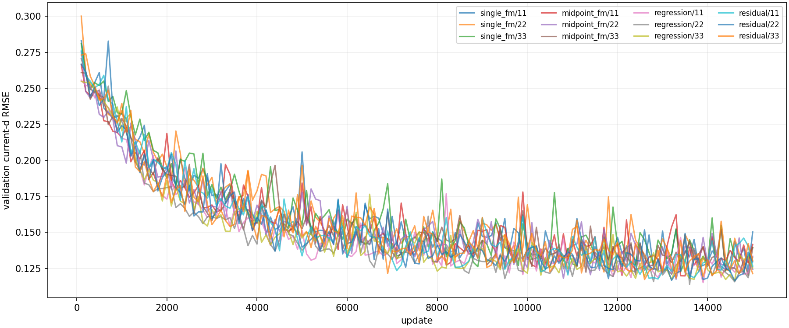
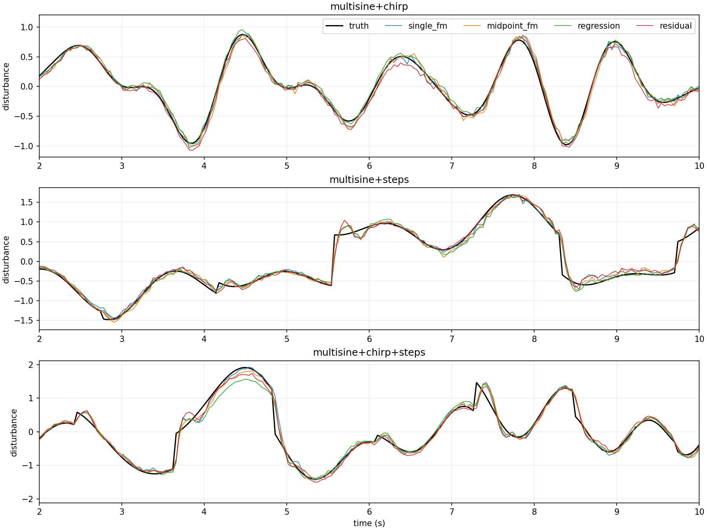

# 单次调用 FM、微小源噪声与五倍混合轨迹实验报告

生成时间：2026-10-21T18:11:00.394733+08:00

## 实现与损失

单步预测：`prediction = source + v_theta(source, condition, source, tau=0)`。网络输出仍是速度，积分跨度为1；不把tau=1当成已知终点。训练结果分支与部署调用同一实现。
速度监督保持原方案：每个batch样本独立随机抽tau，`z=(1-tau)*s_aug+tau*y`，目标速度`y-s_aug`。
每个训练batch在归一化source上重新加入独立零均值高斯白噪声；FM插值、目标速度与结果分支共同使用同一份扰动后的source。x/v/u、标签和归一化统计不加这项噪声，验证、测试和部署也不加。
白噪声标准差为归一化单位 0.01，对应物理扰动单位 0.006553。
结果损失：`mean((prediction-y)^2) + 4*mean((prediction[:,0]-y[:,0])^2)`；FM总损失为速度损失加结果损失，权重均为1。
条件为过去至当前24点x、v、u和3个已知参数；source为过去24点扰动残差；目标为当前至未来24点真实扰动。仅第一项用于当前扰动估计，未来项为辅助监督。

## 数据与训练配置

训练轨迹 360 条（原72条的 5.0 倍），验证 90 条，每个测试噪声场景 56 条。
轨迹包含多正弦、chirp、阶跃加小正弦，以及三种两两叠加和三者同时叠加。混合分量权重从[0.5,1]随机抽取后按L2范数归一化；混合分量在同一轨迹中同时存在。
每条16秒，dt=0.02秒。训练窗口 136080，验证窗口 17010。
训练family计数：`{"multisine": 52, "chirp": 52, "steps": 52, "multisine+chirp": 51, "multisine+steps": 51, "chirp+steps": 51, "multisine+chirp+steps": 51}`。
训练/验证/测试按整条轨迹隔离，随机种子分别为10000/20000/50000；各测试噪声场景共享相同底层轨迹和系统参数。归一化只拟合训练集。
CPU训练，线程 4，随机种子 [11, 22, 33]；每模型 15000 次更新，batch=128，宽度=128，AdamW学习率=0.001，weight_decay=1e-4，梯度裁剪5。
默认15000次更新是原3000次的5倍，以维持训练数据扩大5倍后的大致采样覆盖率。每100次更新验证，按当前扰动验证RMSE选择最佳检查点；报告使用最佳检查点。
四个模型共享数据、噪声增强尺度、更新次数和验证选择规则；不同模型的随机数消耗不同，因此不声称每步抽到完全相同的样本或白噪声。

## 模型容量、调用次数与耗时

| 方法 | 参数量 | 单次预测网络调用 | batch=1中位耗时(ms) | P95(ms) | 已记录训练秒数† |
|---|---:|---:|---:|---:|---:|
| single_fm | 86296 | 1 | 0.0656 | 0.0708 | 24.0 ± 15.3 |
| midpoint_fm | 86296 | 8 | 0.5656 | 0.6019 | 105.7 ± 1.4 |
| regression | 82712 | 1 | 0.0538 | 0.0546 | 26.1 ± 2.4 |
| residual | 82712 | 1 | 0.0547 | 0.0562 | 24.2 ± 0.9 |

†single_fm种子33和residual种子22经历保存中断，表中这两种方法的训练耗时未包含中断前的部分，属于下界；不用于训练加速比结论。详情见文末执行记录。

single_fm与midpoint_fm采用同一网络结构，后者中点积分4步；regression直接输出目标，residual输出source加修正量。延迟取第一个训练种子的模型，预热30次、逐次测量300次，包含张量预测路径，不含传感器采集、NumPy归一化和控制器。调用次数由forward hook实测。参数量相近，但多步FM的训练及推理计算量明显更大，不属于等算力比较。

## 当前扰动测试RMSE

| 方法 | Gaussian 0.2 | Gaussian 0.5 | Gaussian 0.9 | Student-t(3) 0.5 |
|---|---:|---:|---:|---:|
| single_fm | 0.10503 ± 0.00394 | 0.11604 ± 0.00159 | 0.13791 ± 0.00314 | 0.12432 ± 0.00192 |
| midpoint_fm | 0.10473 ± 0.00177 | 0.11471 ± 0.00163 | 0.13343 ± 0.00245 | 0.11887 ± 0.00178 |
| regression | 0.10478 ± 0.00302 | 0.11139 ± 0.00239 | 0.12515 ± 0.00175 | 0.11120 ± 0.00252 |
| residual | 0.10648 ± 0.00188 | 0.11352 ± 0.00072 | 0.13169 ± 0.00221 | 0.12300 ± 0.00079 |
| raw | 0.20171 | 0.50428 | 0.90770 | 0.50961 |
| ema | 0.19991 | 0.25132 | 0.35420 | 0.25144 |
| local_poly | 0.15026 | 0.30441 | 0.52815 | 0.30497 |
| kalman | 0.13911 | 0.26777 | 0.39777 | 0.26835 |
| physics_backward | 0.04000 | 0.04000 | 0.04000 | 0.04000 |

±为共享数据下不同训练种子的样本标准差，不是置信区间或独立数据集重复。滤波参数只用验证集选择。Student-t噪声未参与训练；混合信号族在训练中出现，不属于信号族OOD。

## 中等高斯噪声下各信号族RMSE

| 信号族 | single_fm | midpoint_fm | regression | residual |
|---|---:|---:|---:|---:|
| multisine | 0.08580 ± 0.00801 | 0.09037 ± 0.00156 | 0.08305 ± 0.00167 | 0.08162 ± 0.00327 |
| chirp | 0.06885 ± 0.00598 | 0.07071 ± 0.00568 | 0.06073 ± 0.00071 | 0.06239 ± 0.00335 |
| steps | 0.14832 ± 0.00056 | 0.14413 ± 0.00023 | 0.14429 ± 0.00532 | 0.14854 ± 0.00129 |
| multisine+chirp | 0.07578 ± 0.00315 | 0.07896 ± 0.00417 | 0.06497 ± 0.00224 | 0.06766 ± 0.00171 |
| multisine+steps | 0.13505 ± 0.00236 | 0.13184 ± 0.00148 | 0.13071 ± 0.00486 | 0.13352 ± 0.00273 |
| chirp+steps | 0.12820 ± 0.00094 | 0.12578 ± 0.00325 | 0.12292 ± 0.00216 | 0.12547 ± 0.00137 |
| multisine+chirp+steps | 0.14023 ± 0.00410 | 0.13674 ± 0.00131 | 0.13789 ± 0.00217 | 0.13935 ± 0.00169 |

## 冻结权重的闭环冲击压力测试

所有网络沿用上述开环混合数据训练的权重，未做闭环适配或脉冲微调。24条独立12秒轨迹，含平滑扰动和宽0.02/0.08/0.20秒矩形冲击。沿用原控制器及饱和限制；各方法相同历史热身，仿真未加入实测计算延迟。这是控制分布变化和短脉冲的压力测试，不能与旧closed_adapted实验直接归因比较。
| 方法 | 扰动RMSE | 冲击RMSE | 跟踪RMSE | 饱和比例 |
|---|---:|---:|---:|---:|
| none | 0.51070 | 7.83681 | 0.01079 | 0.0000 |
| dob | 0.37601 | 4.66419 | 0.00466 | 0.0000 |
| kalman | 0.41473 | 3.71384 | 0.00463 | 0.0000 |
| single_fm | 0.85101 | 7.20750 | 0.00935 | 0.0002 |
| midpoint_fm | 0.77900 | 7.36696 | 0.00454 | 0.0000 |
| regression | 0.60012 | 7.29376 | 0.00502 | 0.0000 |
| residual | 0.74909 | 7.32381 | 0.00434 | 0.0002 |

RMSE按种子及等长轨迹的MSE平均后开方；冲击RMSE仅统计有冲击轨迹。

## 结果解释与限制

本次中等高斯噪声下最佳神经网络为 **regression**（RMSE=0.11139）。single_fm相对midpoint_fm的RMSE变化为 +1.16%，相对residual为 +2.22%。正值表示误差增大。
实测预测路径中位耗时，single_fm相对midpoint_fm加速 8.62 倍。是否采用单步方案，应同时考虑表中各噪声条件、信号族和闭环指标，不能仅凭调用次数判断精度。

单步预测在使用时等价于条件残差回归；保留的FM损失是辅助约束，它是否带来收益由与residual的实际结果判断，不宣称自动继承生成分布或不确定性建模能力。
相较旧main，同时改变了训练数据规模、信号族、训练更新数、源噪声和预测方式；本报告不能把与旧结果的差异单独归因于某一项。未做无源噪声消融，无法独立判断1%白噪声是否改善泛化。
准确x/v和已知模型参数的假设有利于physics_backward；真实传感器、模型失配、闭环计算延迟和硬件部署尚未验证。各方法虽共享信息，但历史长度和计算预算不同。

闭环结论补充：单步FM的跟踪RMSE为0.00935，多步FM为0.00454，前者约为后者的2.06倍。因此，本次单步模型的开环精度接近，并不代表闭环冲击表现也接近。这些权重没有经过闭环或脉冲适配，结果不足以支持直接替换现有闭环模型。

对照结论补充：直接回归在四档噪声下的当前扰动RMSE均值均低于单步FM，预测路径耗时也更低；本次配置没有显示单步FM优于直接回归的优势。这不排除其他训练配置的可能性，但不能将本次单次调用的速度收益表述为对回归网络的优势。

## 复现与文件

```powershell
.\.venv\Scripts\python.exe -m unittest test_core test_single_step closed_loop.test_core -v
.\.venv\Scripts\python.exe single_step_experiment.py
# 中断后使用相同参数并加 --resume；仅重新生成报告用 --evaluate-only
```

实际配置见config.json，环境见environment.json，源文件哈希见source_hashes.json；split_manifest.json记录独立轨迹ID、families和窗口数。每个方法目录包含最佳/末次权重及训练历史；metrics.json、trajectory_metrics.json、closed_metrics.json与predictions_*.npz保留完整分析数据。





## 检查点审计与配对分析

全部12个检查点核对实际完成的更新数、部署调用次数和重复输入的确定性；并核对训练代码的SHA-256与实验记录一致。详情见checkpoint_audit.json。

| 方法 | 种子 | 最佳更新 | 验证RMSE | 部署调用次数 |
|---|---:|---:|---:|---:|
| single_fm | 11 | 11800 | 0.11795 | 1 |
| single_fm | 22 | 14300 | 0.12013 | 1 |
| single_fm | 33 | 13400 | 0.12264 | 1 |
| midpoint_fm | 11 | 13500 | 0.11979 | 8 |
| midpoint_fm | 22 | 13300 | 0.11745 | 8 |
| midpoint_fm | 33 | 14900 | 0.12016 | 8 |
| regression | 11 | 13900 | 0.11519 | 1 |
| regression | 22 | 13600 | 0.11392 | 1 |
| regression | 33 | 14600 | 0.11651 | 1 |
| residual | 11 | 12900 | 0.11764 | 1 |
| residual | 22 | 14600 | 0.11635 | 1 |
| residual | 33 | 12600 | 0.11724 | 1 |

整段24点辅助预测RMSE（含当前及未来，不等同于当前扰动估计误差）：

| 方法 | Gaussian 0.2 | Gaussian 0.5 | Gaussian 0.9 | Student-t 0.5 |
|---|---:|---:|---:|---:|
| single_fm | 0.43195 | 0.44227 | 0.46510 | 0.44156 |
| midpoint_fm | 0.44446 | 0.45442 | 0.47622 | 0.45416 |
| regression | 0.43547 | 0.44142 | 0.45570 | 0.43992 |
| residual | 0.43366 | 0.44253 | 0.46489 | 0.44203 |

以下先对同一轨迹的不同种子MSE求平均，再对轨迹平均后开方。使用相同轨迹索引配对bootstrap，整条轨迹为重采样单位，5000次。差值=single_fm RMSE减去对照RMSE，负值有利于single_fm。区间仅描述固定训练集及这组模型下测试轨迹抽样的不确定性，不包含训练集变动，也未做多重比较校正。

| 场景 | 对照 | RMSE差值 | 配对bootstrap 95%区间 |
|---|---|---:|---:|
| gaussian_low | midpoint_fm | +0.00033 | [-0.00080, +0.00143] |
| gaussian_low | regression | +0.00027 | [-0.00108, +0.00163] |
| gaussian_low | residual | -0.00141 | [-0.00258, -0.00013] |
| gaussian_mid | midpoint_fm | +0.00133 | [+0.00007, +0.00252] |
| gaussian_mid | regression | +0.00464 | [+0.00324, +0.00596] |
| gaussian_mid | residual | +0.00253 | [+0.00139, +0.00372] |
| gaussian_high | midpoint_fm | +0.00449 | [+0.00301, +0.00597] |
| gaussian_high | regression | +0.01277 | [+0.01089, +0.01469] |
| gaussian_high | residual | +0.00624 | [+0.00491, +0.00767] |
| student_ood | midpoint_fm | +0.00545 | [+0.00190, +0.00977] |
| student_ood | regression | +0.01311 | [+0.00512, +0.02398] |
| student_ood | residual | +0.00133 | [+0.00001, +0.00269] |

独立三分量混合轨迹 91000:0 通过公开DisturbanceEstimator API逐点运行：778次估计共调用网络778次，当前扰动RMSE=0.11515。这验证了真实历史输入的部署路径，但单条轨迹不作为整体泛化结论。

补充分析复现：`.\.venv\Scripts\python.exe analyze_single_step.py`。

执行记录：single_fm种子33在保存末次检查点时两次遇到文件访问错误，分别从7700和12300次更新的完整检查点恢复；前两个完成的种子直接复用。第二次恢复前将原生torch路径覆盖保存改为Python文件流写入临时文件、原子替换并对短暂锁定重试。随后residual种子22在替换JSON训练历史时遇到短暂目标文件锁，从3700次更新的完整检查点恢复；将同样的重试扩展到JSON原子替换。两次代码修复都仅改变存储，不改损失、网络、优化器、数据或模型随机数消耗。中间版本源码及精确哈希保存在provenance/experiment_before_atomic.py和experiment_checkpoint_atomic.py，源码版本历史见source_hash_history.json。模型训练完整性由checkpoint_audit.json核验。training_stats.json仅记录完整返回的训练调用，因此single_fm种子33和residual种子22的已记录训练耗时不包含中断前部分；这两种方法训练耗时汇总是下界，不能用于严格训练加速比结论。最终推理延迟独立实测，不受这项计时缺失影响。
