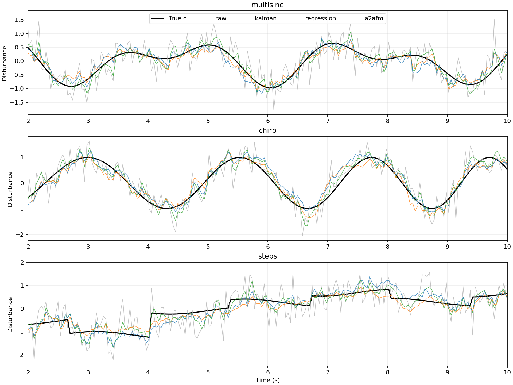
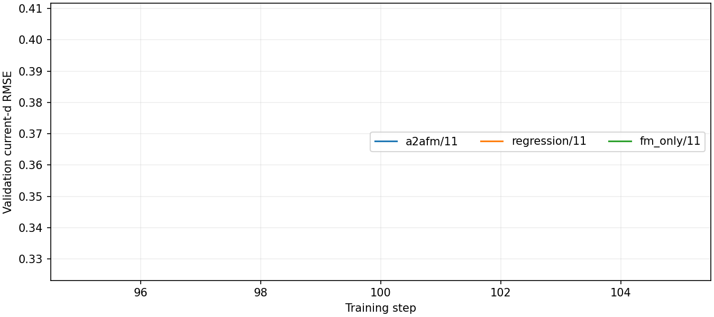

# 实验结果

生成时间：2026-10-13T23:09:43.617434+08:00

设备：cpu；训练轨迹 6；验证轨迹 18；每场景测试轨迹 6；随机种子 [11]。
窗口 L=24，dt=0.02 s；训练 100 steps/model；中点积分 4 步。

## 当前扰动 d(t) 的测试 RMSE

| 方法 | Gaussian 0.2 | Gaussian 0.5 | Gaussian 0.9 | Student-t OOD 0.5 |
|---|---:|---:|---:|---:|
| raw | 0.19976 | 0.49941 | 0.89894 | 0.49077 |
| ema | 0.19193 | 0.25160 | 0.36140 | 0.23630 |
| local_poly | 0.13505 | 0.29736 | 0.52531 | 0.30106 |
| kalman | 0.12984 | 0.26640 | 0.42305 | 0.27009 |
| physics_backward | 0.03836 | 0.03836 | 0.03836 | 0.03836 |
| a2afm | 0.22063 | 0.26741 | 0.37931 | 0.32544 |
| regression | 0.20287 | 0.25301 | 0.34767 | 0.25245 |
| fm_only | 0.33438 | 0.35351 | 0.51864 | 0.41225 |

中等高斯噪声下，A2AFM 相对原始估计的 RMSE 降低 46.45%。

表中 ± 为训练随机种子间样本标准差，不是置信区间；各方法共享测试轨迹。
滤波方法按验证集调参；神经网络按验证当前时刻 RMSE 选择检查点。完整分信号指标见 metrics.csv，逐轨迹指标见 trajectory_metrics.csv。

## 必须保留的解释
- 这是 A2A 思想的信号空间改编，不是原机器人任务的复现；不存在隐空间编码/解码。
- 网络仅使用截至 t 的观测，未来 d 只作训练标签。测试时返回整段预测，但应用只取首项。
- 精确 x/v 的假设使 physics_backward 基线特别强；它使用相同可用信息。不能据此宣称 FM 优于物理方法。
- EMA、局部多项式、Kalman 只使用 d_hat；神经网络额外使用 x/v/u/A，须区分信息量差异。
- Student-t 为未训练噪声分布；阶跃属于训练中出现的信号族，不能称为信号族 OOD。
- 仿真真值来自已知方程；尚无真实传感器数据，未测试系统模型失配或 x/v 含噪。

